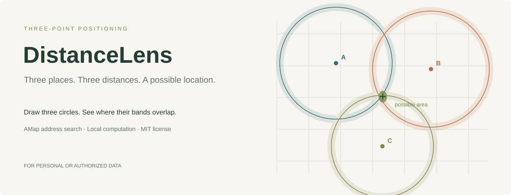
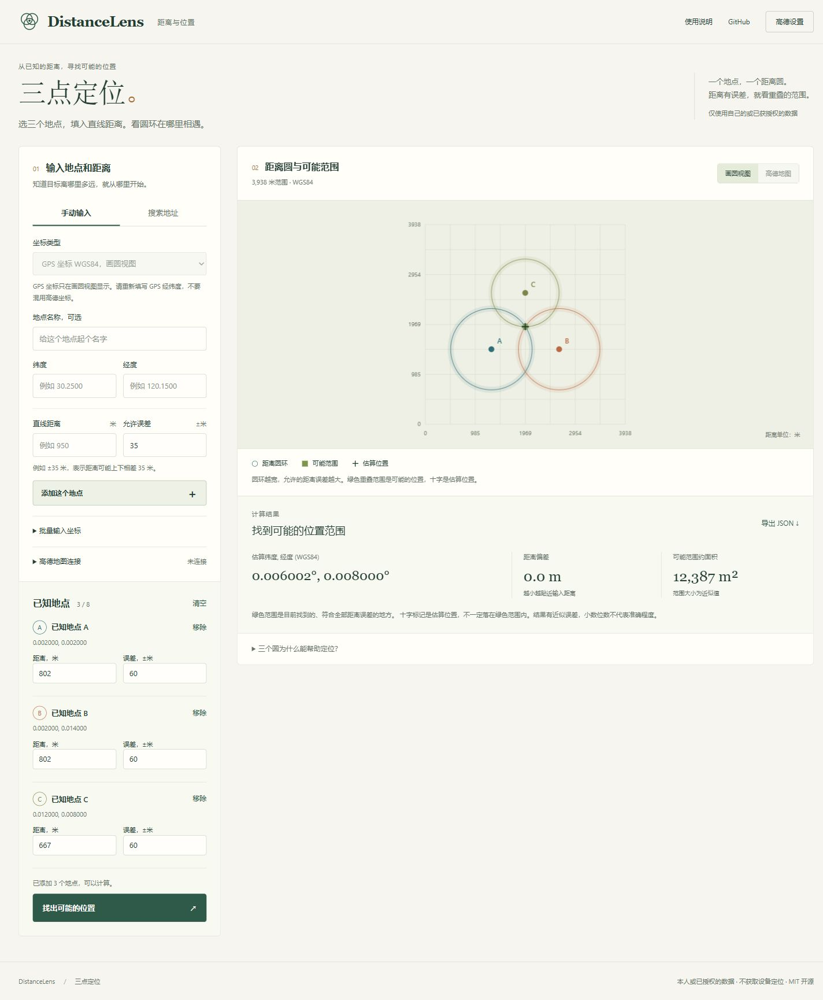

<div align="center">
  
  <h1>DistanceLens</h1>
  <p>Search reference places, enter distances, and inspect where the constraints overlap.</p>
  <p><a href="README.md">简体中文</a> | <strong>English</strong></p>
  <p>
    <a href="LICENSE"></a>
    <a href="package.json"></a>
    
    <a href="https://github.com/1812370360/distancelens/stargazers"></a>
  </p>
  <p><a href="https://1812370360.github.io/distancelens/">Live demo</a> · <a href="#quick-start">Quick start</a> · <a href="#amap-setup">AMap setup</a> · <a href="https://github.com/1812370360/distancelens/issues">Report an issue</a></p>
</div>

## About

DistanceLens is a browser-based multilateration tool for **your own data or data you are authorized to use**. Add known reference coordinates and straight-line distances to a target. The app visualizes distance annuli, the sampled feasible region, and a least-squares estimate.

There is one data-entry workflow, with no simulation mode. Geometry calculations run locally. AMap is optional and provides place search and a map background.

## Project showcase

[Try the live demo](https://1812370360.github.io/distancelens/) · [AMap setup](#amap-setup)



The illustration explains the geometry and is not a real map or a measured result.

<details>
<summary>View the application interface</summary>



The current interface is in Chinese. The screenshot shows manual entry and AMap configuration, with no live API key configured.
</details>

## Features

- **AMap place search:** search by city and place name, then select an address to fill its coordinates.
- **Manual coordinates:** supports GCJ-02 for AMap or WGS84 in the geometry view.
- **Independent constraints:** 3–8 reference points, each with its own distance and tolerance.
- **Annulus overlays:** inspect distance bands and the sampled common region.
- **Least-squares estimate:** displays estimated coordinates, RMS distance residual, and approximate candidate area.
- **Editable input:** change distances and tolerances, remove points, or replace them through bulk input.
- **JSON export:** includes input, projection parameters, sampled region, and the estimate.
- **Responsive interface:** no build step, package installation, or device-location permission required.

## Quick start

Install Node.js 22 or newer, then run:

```sh
git clone https://github.com/1812370360/distancelens.git
cd distancelens
npm start
```

Open [http://127.0.0.1:4173](http://127.0.0.1:4173). Manual input and the geometry view work without an AMap key. For offline geometry, you can also open `dist/index.html` directly. AMap should be used through HTTP with the appropriate allowed domains.

```sh
npm test
```

Tests cover the solver, projection, inconsistent constraints, ambiguous solutions, and the AMap adapter. Adapter tests use SDK substitutes and do not replace live service testing.

## AMap setup

1. Create an application in the [AMap developer console](https://console.amap.com/dev/key/app).
2. Create a **Web (JS API)** key and obtain its `securityJsCode`.
3. Enter both values in the application's AMap connection panel and connect.
4. Search for a place, select the correct result, and enter the target's straight-line distance and tolerance.
5. Add at least three reference points and calculate.

Keys created after December 2, 2021 require the security code. Domain restrictions, service permissions, and quotas are managed in your AMap account. No valid credentials are bundled. See the [official key guide](https://developer.amap.com/api/javascript-api-v2/prerequisites) and [security guide](https://developer.amap.com/api/javascript-api-v2/guide/abc/jscode).

For production, use a security proxy with `serviceHost`, such as `https://your-domain.example/_AMapService`. Keep `securityJsCode` on your server. The app supports this configuration; a proxy server is not included.

## Input and coordinate systems

AMap uses **GCJ-02**. WGS84 input is displayed only in the geometry view. Coordinates are never silently converted. The coordinate system is locked after adding a point and can be changed after clearing the list.

Bulk input uses one reference point per line, without a header:

```text
latitude,longitude,straight_line_distance_m,tolerance_m
```

Tolerance is optional and defaults to 35 m. Bulk import replaces the current points. Limits: latitude ±80°, distances and reference-point separation up to 10 km, and tolerance from 1 to 500 m. Do not enter driving or walking route lengths.

## How it works

A point p is feasible when every reference point satisfies:

```text
abs(distance(p, anchor_i) - observed_distance_i) <= tolerance_i
```

The solver minimizes the sum of squared distance residuals with 25 starting points, damped Gauss–Newton, and backtracking. Global optimality is not guaranteed. Tolerance controls the feasible region; it is not a least-squares weight.

Coordinates are projected onto a local spherical plane using a radius of 6,371,008.8 m. This is an approximation, not an exact ellipsoidal geodesic solver. GCJ-02 introduces additional local distortions.

The feasible region is sampled on a 240 × 240 grid. Thin intersections can be missed. No sampled overlap is not proof that no solution exists. Collinear anchors can yield mirror solutions; the estimate displays only one. The candidate region is not a statistical confidence interval, and displayed decimal places do not guarantee accuracy.

## Privacy and responsible use

Use only personal or authorized data. The project does not identify screenshots, collect other people's location data, or request device geolocation.

Without AMap, there are no external requests. With AMap connected, searches, SDK loading, map tiles, and map-view requests use AMap services. Calculations remain local, but the third-party SDK runs in the page and is not an isolated privacy boundary. Input and credentials are not persisted by the app or included as credentials in exports. Exported JSON does contain location inputs. Refreshing clears the input; third-party SDK behavior is governed by AMap's policies.

## Technology

| Component | Implementation |
| --- | --- |
| Interface | HTML, CSS, vanilla JavaScript |
| Geometry view | Canvas 2D |
| Maps and place search | AMap JS API 2.0, PlaceSearch |
| Solver | Multi-start nonlinear least squares |
| Local server and tests | Node.js built-in modules |
| Deployment | Static hosting, optional GitHub Pages workflow |

## Repository structure

```text
distancelens/
├── dist/
│   ├── index.html
│   ├── style.css
│   ├── app.js
│   ├── solver.js
│   └── amap-adapter.js
├── docs/assets/
├── tests/
├── .github/workflows/pages.yml
├── server.cjs
├── package.json
├── README.md
├── README.en.md
└── LICENSE
```

## Deployment and contributions

Serve `dist/` on a static host. For GitHub Pages, choose **GitHub Actions** in Settings → Pages and run the included workflow. Allow the deployed hostname in your AMap key settings.

Issues and pull requests are welcome. Run `npm test` before submitting a change. Never commit API keys, security codes, or personal location datasets.

## License

[MIT](LICENSE).
